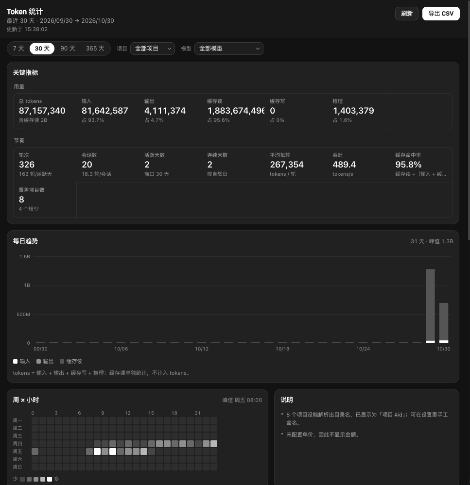

# BoneTokenStatistics

跨所有项目的 token 用量统计视图（插件 id `bone.token.statistics`）。工作面板里的
一页只读仪表盘：按时间、项目、模型、会话汇总已完成轮次的 tokens、轮次、会话与
可选的成本估算。

- 视图入口：`contributes.views[0]` → `views/index.html`（单文件，无构建步骤）
- 面板通道：`stats.snapshot`（整份快照）、`stats.ping`（默认天数 / 币种）
- 打开方式：命令「BoneTokenStatistics: 打开统计」（`bone.stats.open`）

## 界面预览

## 它显示什么

| 区块 | 内容 |
| --- | --- |
| 页头 | 标题、时间窗（`最近 N 天 · 起 → 止`）、更新时间、`已截断` 徽标、刷新、导出 CSV |
| 筛选栏 | 7 / 30 / 90 / 365 天（默认取 `defaultDays`）、项目下拉、模型下拉、清除筛选 |
| 关键指标 | 总 tokens、输入、输出、缓存读、缓存写、推理、轮次、会话数、活跃天数、连续天数、平均每轮、吞吐（tokens/s）、缓存命中率、覆盖项目数；有成本时增加「估算成本」 |
| 每日趋势 | 输入 / 输出 / 缓存读 的堆叠柱状图（内联 SVG），按天悬停或键盘逐日查看明细 |
| 周 × 小时 | 7 × 24 热力图，5 级强调色深浅，最忙时段写进面板副标题 |
| 项目 | 按 tokens 排序的表格，可展开看该项目的模型分布 |
| 模型 | 模型 id、provider、tokens、占比、轮次、平均每轮、tokens/s、缓存读；有成本时再加金额 |
| 会话 | 用量最高的会话（插件侧最多 20 条）：标题、项目、模型、tokens、轮次、最近活动 |
| 说明 | 原样渲染宿主给的 `notes`（截断、无单价、无法命名项目等） |

数字来源约定：`tokens = 输入 + 输出 + 缓存写 + 推理`；`cacheRead` 单独统计、不计入
`tokens`，`tokensWithCacheRead` 只用于「含缓存读」这类副标题。

## 权限

| 权限 | 用途 |
| --- | --- |
| `ui.view` | 声明并打开工作面板视图 |
| `usage.read` | 只读 `pi.usage.listTurns`（已完成轮次的 token 计数，不读消息正文） |
| `desktop.control` | 仅调用受控只读操作 `project/list`，读取项目 ID、当前名称和路径，不读取会话正文 |

插件不写任何数据，不访问网络，不读消息内容。

## 设置

| 键 | 作用 |
| --- | --- |
| `defaultDays` | 打开视图时的默认范围：7 / 30 / 90 / 365，默认 30 |
| `maxTurns` | 单次统计最多读取的轮次数，默认 20000（每页 500，最多 400 页） |
| `rates` | 单价表 JSON：`{"模型 id": {"input": 0.5, "output": 2, "cacheRead": 0.05}}`，单位是每百万 token。留空 = 完全不显示金额 |
| `currency` | `CNY` / `USD`，只影响显示符号，不做汇率换算 |
| `projectNames` | 项目显示名 JSON：`{"12": "Framecraft"}`，优先于自动解析出的目录名 |

## 数据怎么进到面板

`stats.snapshot` 一次返回整页所需的全部聚合结果（插件进程内计算，渲染进程不分页、
不聚合）：

| 载荷字段 | 去的面板 |
| --- | --- |
| `window.days / fromMs / toMs`、`generatedAt`、`truncated.hits` | 页头时间窗、更新时间、`已截断` 徽标 |
| `filters.projectId / modelId`、`settings.defaultDays` | 筛选栏当前选中项 |
| `totals.*` | 关键指标两排瓦片 |
| `days[]` | 每日趋势（输入 / 输出 / 缓存读堆叠，缺数据的日期留空槽） |
| `heat[7][24]` | 周 × 小时热力图（周一为第 0 行） |
| `projects[]`（含 `models[]`） | 项目表 + 展开后的模型分布 |
| `models[]`、`cost.byModel / unpricedModels` | 模型表，以及「金额」列与「无单价」标记 |
| `sessions[]` | 会话 Top 列表 |
| `notes[]` | 说明面板，逐条原样显示 |
| `cost.total / currency / pricedTokens / unpricedTokens` | 「估算成本」瓦片与其副标题 |

视图行为：

- 切换天数 / 项目 / 模型都会重新调用 `stats.snapshot`，参数形如
  `{days: 30}`、`{days: 30, projectId: 12}`、`{days: 30, projectId: 12, modelId: "claude-sonnet-4"}`，
  筛选在插件侧完成，前端不二次过滤。
- 手动刷新带 `force: true`；页面可见时每 60 秒轮询一次，切到后台暂停。
- 导出 CSV 由当前快照在本地生成（按天 / 按项目 / 按模型三段，UTF-8 BOM，
  文件名 `bone-token-stats-30d-2026-10-29.csv`）。
- 外观（深 / 浅色）与语言（`zh-CN` / `en`）来自 `app.getAppearance()` 与
  `appearance:changed`，不跟随 `prefers-color-scheme` 之外的宿主假设。

## 三个诚实的边界

1. **没有价格就没有金额。** 宿主只提供 token 计数，金额全部来自 `rates` 里手写的
   单价。没有配置时整页不出现任何货币符号，`cost` 为 `null`，说明面板会写明原因；
   只配置了部分模型时，其余模型的金额列显示「无单价」，`cost.unpricedTokens` 单独计数。
2. **项目名称来自当前宿主目录。** 用量行的数字 `projectId` 与 `project/list` 返回的项目 ID 对应。
   名称优先级为手动 `projectNames` 设置、宿主项目名称、路径末级目录名；已删除或无法读取的
   项目仍显示 `项目 #id`。不读取会话、不永久缓存名称；点击刷新会重新读取最新名称。
   此处对应宿主的目录项目记录，不将逻辑项目组的字符串 ID 与用量数字 ID 混用。
3. **365 天与行数上限。** 读取量受 `maxTurns` 限制（默认 20000 轮）。超过时窗口起点
   会前移、只保留最近的轮次，页头显示 `已截断`、说明里给出实际上限与前移后的起点；
   365 天视图里日趋势最多铺 400 个日槽，柱子退化成密度条，横轴只画 3–6 个聚合刻度。
   会话列表同样只保留插件返回的 Top 20。

另外两点容易误读的地方：轮次统计只覆盖「已完成」的轮次（`pi.usage.listTurns`
的定义），进行中的轮次不计；项目 / 模型的「占比」分母是当前筛选后的总 tokens。

## 许可

MIT，全文见 [LICENSE](LICENSE)。Copyright (c) 2026 taokoplay。

- 允许：商用、修改、分发、私有使用，保留版权与许可声明即可。
- 不含担保：作者不对用量统计的准确性或由此产生的损失负责。
- 数据边界：插件只读宿主提供的已完成轮次计数，不收集、不上传任何内容；你填在设置里的
  单价表、币种与项目显示名只保存在本机插件设置中。

## 0.1.1 升级说明

修复项目名称全部回退成编号的问题：原实现错误地用 `session.read` 权限调用仅允许
插件自有会话的 `session.get`。现改用 `project/list`，并移除 40 个项目的查名上限和
进程级名称缓存。

升级需要接受新增的 `desktop.control` 权限；插件仅使用其只读项目列表操作。请导入
`dist/bone.token.statistics-0.1.1.piplug`，确认权限后点击统计页“刷新”。若通过开发目录
加载，请在插件页面重新加载以重新审核权限，普通文件热更新不能扩大权限。

回归验证：`node --test tests/project-names.test.cjs`（3 项）、
`node tests/backend.test.cjs`（60 项）、`node tests/unit.test.cjs`（23 项）。
未在用户运行中的桌面实例上进行安装验证。

## 0.1.2 布局更新

周 × 小时热力图的 24 列自动等分卡片可用宽度，消除宽卡片右侧留白，并减少窄屏横向滚动。小时标签与数据列同步伸缩，星期行和统计口径不变。
